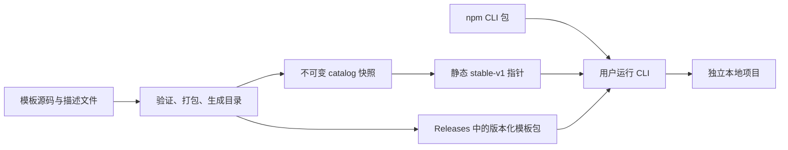

# 多技术栈模板仓库结构与 CLI 分发架构

- 方案索引ID：`DES-BE-20261019-001`
- Change ID：`20261019-template-repository`
- 日期：2026-10-19
- 状态：历史架构基线；用户已授权框架实现，实际模板后续维护；当前实施范围以 DES-BE-20261019-002 为准
- Agent：`design-manager`
- 使用 skill：`req-dev`、`architecture-designer`、`brainstorming`

## 1. 目标与现状

将本仓库演进为个人长期维护的项目模板集合。使用者通过一条 CLI 命令选择模板，获得可以独立安装依赖、构建和运行的项目。技术栈覆盖 React + Vite、Next.js、Flutter、NestJS、Java、LangChain TypeScript/Python，并允许以后增加其他框架。

本次已读取 `ai-workflow/memory/INDEX.md`、`TEAM.md` 和存在的 `LOCAL.md`；两个偏好文件目前仅有标题，没有额外约束。按 `phase-router.md` 路由并加载 `design-manager.md`，读取根 `AGENTS.md` 与 skills 索引。现有仓库没有应用源码、应用构建清单或全局业务/规则索引；本变更包已建立 SDD 设计文档。工作区已有 `AGENTS.md` 修改，予以保留。

### 需求边界

| 维度 | 设计要求 |
| --- | --- |
| 使用体验 | 无需克隆模板仓库，无需预先全局安装本 CLI；选择模板后创建项目 |
| 技术栈 | 同一仓库存放多语言模板，各自使用原生工具链 |
| 仓库与项目形态 | 单 Git 仓库集中维护 CLI 与模板；首版只有一个 CLI 包，monorepo 作为按实际需求新增的可选模板 |
| 可维护性 | 添加模板主要是新增目录、描述文件和验证配置，避免改动 CLI 分支；每个模板可独立开发、运行和测试，运行产物不回流基础模板 |
| 分发成本 | 首版使用现成 npm 与静态文件托管，无自建服务、数据库或账号系统 |
| 可重复生成 | 可以指定模板版本；记录来源、参数和校验信息；不承诺依赖生态永久可用 |
| 平台 | CLI 面向 macOS、Linux、Windows；具体模板声明自身构建平台限制 |

设计默认 CLI 通过 npm / npx 使用，需要 Node.js；运行已生成的 Java、Flutter、Python 项目只需其模板要求的工具链。Node.js、SDK 与包管理器的具体支持版本在实现时选择并锁定。包名 `create-charon-forge`、命令及托管地址在本文中均为拟议接口，尚未发布或核实名称占用情况。

本次不实现项目代码、不迁移现有目录、不发布软件。首版产品范围是创建新项目；已有项目的模块合并、模板升级迁移、任意插件组合和私有模板认证留待独立需求。

## 2. 推荐架构与备选方案

推荐 **单 Git 仓库 + 单 CLI 包 + 独立模板目录 + 静态模板分发**。

| 方案 | 优点 | 代价与适用性 |
| --- | --- | --- |
| 单仓库，CLI 按需下载模板（推荐） | 模板可独立更新，CLI 小，跨语言一致分发 | 需要维护一个静态 catalog 发布流程；适合长期增加多种模板 |
| 单仓库，把所有模板装进 CLI npm 包 | 发布步骤最少，可随包携带完整模板 | 每次执行首次下载所有模板，模板更新必须发 CLI；适合极少量模板的试验版 |
| 每个模板独立仓库，中央 CLI 索引 | 模板可以有独立团队、权限和生命周期 | 跨仓库维护、验证和版本治理增加；个人当前维护规模不需要 |



图中“目录”是模板索引数据，以下称 catalog，和 npm/pnpm 的软件包 registry 不是同一个概念。CLI 不要求用户安装 Git，也不下载整个仓库。

## 3. 建议仓库结构

下图是目标布局，除现有协作文件及本次 SDD 文档外，其余目录均为建议新增内容；模板清单展示可扩展范围，不表示首期全部实现。

```text
charon-forge-template/
├── cli/                            # CLI 源码目录，不单独设置 package.json
│   └── src/
│       ├── index.ts                 # CLI 入口
│       ├── commands/                # 参数、交互、错误展示
│       └── core/                    # catalog、下载、校验、渲染、落盘
├── templates/                       # 相互隔离的项目模板
│   ├── web/
│   │   ├── react-vite/
│   │   └── nextjs/
│   ├── mobile/
│   │   └── flutter/
│   ├── server/
│   │   ├── nestjs/
│   │   └── java-spring-boot/         # Java 框架的一种候选，可继续扩展
│   ├── agent/
│   │   ├── langchain-ts/
│   │   └── langchain-python/
│   └── workspace/                   # 有真实成套项目需求时再新增
│       └── next-nest-monorepo/      # 可选示例，非首版必建模板
├── schemas/
│   ├── template.schema.json         # 模板源码描述协议
│   └── catalog.schema.json          # 分发目录与 channel 协议
├── scripts/                         # 本仓库构建维护脚本
│   ├── prepare-template-dev.ts      # 在仓库外生成模板开发工作目录
│   ├── validate-templates.ts
│   ├── pack-templates.ts
│   └── build-catalog.ts
├── tests/                           # CLI / 生成器的集成验证
├── docs/                            # 用户使用与模板贡献说明
├── .github/workflows/               # 验证、CLI 发布、模板发布
├── dist/                            # 构建产物；不手工编辑、不提交
│   ├── cli/                         # 唯一 CLI 包的运行产物
│   ├── templates/                   # 单独发布的模板归档
│   └── catalog/                     # catalog 与 channel 产物
├── package.json                     # 唯一工具包：create-charon-forge，含发布与维护命令
├── pnpm-lock.yaml                   # 仅 CLI 与仓库维护工具的锁文件
├── .gitignore
├── README.md
├── AGENTS.md                        # 现有入口，实际引入代码后再更新事实
├── .codex/skills/                   # 现有协作技能
└── ai-workflow/                     # 现有协作知识库与 SDD
```

顶层 `cli/` 是工具源码，`templates/` 是交付给使用者的内容。`ai-workflow/skills/server` 和 `web` 继续保持技能分类职责。首版根 `package.json` 同时管理 CLI 与维护脚本的依赖和命令，CLI 核心通过内部模块复用；不建立 `template-core` 独立包或根 pnpm workspace。

根包按 `create-charon-forge` 发布，`bin` 指向 `dist/cli/index.js`，不设 `private: true`。npm 包通过 `files` 白名单仅纳入 `dist/cli/` 及必要的用户说明、许可文件；运行时所需资源须随 CLI 构建输出。`templates/`、`scripts/`、`tests/`、`ai-workflow/` 和模板归档、catalog 等其他产物不进入 CLI 包。发布前检查打包清单，避免将整个仓库内容带入 npm。

模板使用浅层“分类 / 模板目录”结构，语言、框架、标签和项目形态放在描述文件中。不要用“技术栈 / 语言 / 包管理器 / ORM / UI 库”继续分层；新增分类不应要求重写生成引擎。

## 4. 单 CLI 包与可选 monorepo 模板的边界

### 4.1 模板仓库：首版采用单 CLI 包

CLI 是当前唯一对外工具，生成核心没有独立消费者，也不需要独立版本或发布。首版使用一个根包，将参数交互放在 `cli/src/commands/`，生成能力放在 `cli/src/core/`；维护脚本可直接复用内部模块，不需要配置包间依赖、导出和构建顺序。TypeScript、格式化和 lint 的维护范围显式限定为工具源码与脚本，模板负载由专属验证任务处理。

只有实际出现多个需要独立构建或被其他工具复用的工具包时，才重新评估多包 workspace。届时需要调整目录、依赖与构建配置；当前以内部模块保持职责边界即可，不预建插件系统、通用 SDK、后台服务或文档站应用。

模板中的 `package.json`、`pyproject.toml`、`pom.xml`、Gradle 配置、`pubspec.yaml` 归各自模板所有。根目录安装仅处理 CLI 与维护工具的依赖，不安装模板依赖。模板的维护与验证均先生成到仓库外的临时目录，再执行其本地工具链，避免意外使用根 `node_modules`。

每个模板保留自己的锁文件或原生版本固定机制。根 pnpm 版本不能强制所有模板使用同一包管理器；例如 Java 通过 Maven/Gradle Wrapper，Python 可选择 uv，Flutter 使用 Flutter/Dart 工具链。

### 4.2 生成项目：按真实需求提供 monorepo 模板

单应用模板直接采用对应框架的原生工程结构，不统一包装成 `apps/` 与 `packages/`。当实际项目需要前后端共同修改、共享契约，或多个应用复用代码时，再新增一个经验证的完整 monorepo 模板；不要求首版提供，也不预先穷举技术栈组合。

例如确有 Next.js + NestJS 成套需求时，`workspace-next-nest` 可以先生成以下结构：

```text
my-project/
├── apps/
│   ├── web/                         # Next.js
│   └── api/                         # NestJS
├── package.json
├── pnpm-workspace.yaml
└── pnpm-lock.yaml
```

这里的 workspace 配置随模板输出，仅管理生成项目自身的应用和依赖。若有实际共享的契约或代码，再加入 `packages/contracts/` 等共享包，并声明项目内部依赖；不生成空共享包。默认通过根脚本满足安装、构建和启动需要，只有任务依赖、缓存或编排确实带来收益时再引入 Turbo/Nx。

纯前端多应用也可以采用相同原则。全栈模板须验证各应用构建、端口、接口约定和统一启动流程；含共享包时同时验证其依赖关系。生成项目必须能脱离模板仓库独立安装、构建和运行。

如果以后需要 Next.js + Java，二者可在同一生成项目的不同目录维护，用项目任务脚本或其他适用工具编排；Java 依赖继续由其原生工具链管理。模板仓库自身是否采用 workspace，不影响这些可选模板的工程结构。

## 5. 模板单元与统一协议

以一个前端模板为例：

```text
templates/web/react-vite/
├── template.json                    # 名称、版本、参数、要求与操作声明
├── README.md                        # 面向模板维护者
├── CHANGELOG.md
└── files/                           # 将被生成到目标项目根目录的全部文件
    ├── package.json
    ├── pnpm-lock.yaml
    ├── .gitignore
    ├── .env.example
    ├── README.md                    # 面向生成项目的使用者
    └── src/
```

所有技术栈遵循相同的外层目录协议，`files/` 内部完全使用原生工程结构。以下是拟议描述格式示例，不是现有配置：

```json
{
  "schemaVersion": 1,
  "id": "web-react-vite",
  "version": "1.0.0",
  "name": "React + Vite + TypeScript",
  "category": "web",
  "layout": "single",
  "tags": ["react", "vite", "typescript"],
  "minCliVersion": "1.0.0",
  "source": "files",
  "inputs": {
    "projectName": { "type": "string", "required": true }
  },
  "render": {
    "tokens": { "__PROJECT_NAME__": "projectName" },
    "files": ["package.json", "README.md"]
  },
  "requirements": [
    { "tool": "node", "range": ">=22", "phase": "install" },
    { "tool": "pnpm", "range": ">=10", "phase": "install" }
  ],
  "install": { "adapter": "node", "packageManagers": ["pnpm"] },
  "verify": [
    { "argv": ["pnpm", "install", "--frozen-lockfile"] },
    { "argv": ["pnpm", "build"] }
  ]
}
```

### 协议约束

1. `id` 全仓库唯一且稳定；分类与目录可重组，历史 ID 不随意改名。`version` 是模板版本；框架和 SDK 版本由模板工程文件定义。
2. CLI 根据 `template.json` 自动发现模板。使用者可见分类来自元数据，不在 CLI 写 `switch (framework)`。技术栈差异由少量内置安装适配器承接。
3. 首版仅对白名单文本文件执行显式 token 替换，不解析源码里的普通花括号，不触碰二进制。Java 包名、路径重命名和 Flutter application ID 如需参数化，应新增可验证的显式映射；首版没有对应能力就提供固定默认值并写清手动调整方式。
4. 项目名进入 JSON、XML、YAML、文件路径之前必须按字段校验和编码，不能把自由输入直接作为源码或命令片段。名称规则按模板声明，不能对所有语言套同一种包名规则。
5. 模板内只能引用生成项目自身的文件；不引用本仓库的 CLI、维护脚本或依赖。生成的 monorepo 可以在其内部使用 `workspace:*`，引用目标必须随模板一起输出。
6. 标准安装由 CLI 内置适配器完成：Node 使用支持的包管理器，Python 使用其声明的工具，Flutter 使用 Flutter 命令，Java 使用 Wrapper 或打印下一步。依赖安装可选，只有进入安装阶段才要求目标 SDK 存在。
7. `verify` 供维护者 CI 在隔离环境运行，不由用户 CLI 自动执行。首版模板协议不包含任意 JavaScript/Python 初始化 hook；新增语言可以先仅生成文件并输出操作指引。
8. `template.json` 是当前模板元数据的唯一手写来源；catalog 是构建结果，发布流程合并已发布历史，不另维护一份重复的框架列表。
9. 锁文件随模板发布。参数修改会影响锁文件时，由模板包构建与生成验证明确处理；不能为了让安装通过就一律删除锁文件。

因此 Java、Flutter、Python 不需要伪装成 npm 包。CLI 统一的是发现、参数收集、文件生成和错误处理，构建仍交给各自工具链。

### 5.1 独立开发、运行与测试隔离

每个模板的 `files/` 是唯一基础源码，包含完整原生工程及必要的测试、配置、锁文件或 Wrapper。模板独立运行的验收对象是从它生成的工程；安装、启动、构建和测试均在仓库外的独立工作目录中进行，避免修改基础源码、锁文件或依赖解析结果。`files/` 可能包含参数 token，因此不要求它在未渲染时直接启动。

```text
charon-forge-template/templates/web/react-vite/
├── template.json
└── files/                          # 维护并发布的基础工程
    ├── package.json
    ├── pnpm-lock.yaml
    └── src/

<仓库外的开发目录>/react-vite-dev/    # 本地生成的完整工程
├── package.json                    # 已渲染项目参数
├── pnpm-lock.yaml
├── src/                            # 可开发、热更新与测试
├── node_modules/                   # 安装产物
├── dist/                           # 构建产物
├── coverage/                       # 测试产物
└── .env.local                      # 本地配置，不回写基础模板
```

拟议维护入口为根脚本 `pnpm template:dev -- --template web-react-vite --output <仓库外的新目录>`，具体参数在实现时确定。该脚本使用本地模板源码，经同一打包与生成核心生成项目，输出路径和模板原生安装、启动、测试命令；不自动启动服务，不把用户输入拼成 shell。开发准备入口属于维护工具，不增加公开 CLI 的任意本地模板执行能力，也不引入模板初始化 hook。

维护流程：

1. 选择模板和有效参数，生成到独立新目录；参数未给默认值时要求显式填写。首版沿用 CLI 禁止覆盖已有目录的规则，重新生成时选择新目录。
2. 在生成工程中使用原生工具安装依赖、启动开发服务和运行测试。Node 的 `node_modules`、Next.js 的 `.next`、Java 的 `target/build`、Flutter 的 `.dart_tool/build`、Python 的 `.venv/__pycache__` 以及日志、覆盖率、本地数据库均留在工作目录；工具的全局缓存按原生工具管理，不进入模板包。
3. 开发时可以在工作目录中编辑源码以使用热更新。需要保留的变更由维护者查看差异后，逐文件同步回 `files/`；参数化文件需恢复 token。锁文件、资源和配置的有意更新也走相同检查，不把整个工作目录复制回来，不做自动双向同步。
4. 从更新后的基础模板重新生成一个干净工程，执行锁文件安装、构建和必要测试。此前工作目录中的运行状态不作为验收依据；需要真实服务或密钥时按 README 配置，自动验证提供 mock 或最小无账号路径。

模板 README 必须写明安装、启动、构建、测试命令和工具要求；有端口或外部服务时列出配置方式。并行启动多个实例时由各工程配置端口和数据位置，首版不建设服务编排平台。

### 5.2 模板打包边界与防污染验证

开发目录隔离是第一道边界，模板发布另设文件清单约束：

- 在 `template.json` 的 schema 中增加 `publish.include`，显式声明 `files/` 内允许发布的相对路径或 glob。基础负载仅取这些路径与 Git 已跟踪文件的交集；新增基础文件必须先纳入版本管理。本地预览可以使用已跟踪文件的当前修改，正式发布从干净的指定提交构建。
- 打包输入固定为源码模板目录，禁止从开发、验证目录或 `dist/` 反向收集负载。模板包只包含必要描述与选中的基础文件；维护者文档和变更说明由发布流程另行使用。
- 独立于 `.gitignore` 检查各语言的依赖目录、缓存、构建产物、日志、覆盖率和真实环境文件；即使被误跟踪或命中 include，也拒绝打包并报出路径。`.env.example` 等明确允许的公开配置样例、锁文件、Wrapper 和必要的版本化资源保留，不能笼统排除所有点文件或二进制文件。
- `.gitignore` 用于减少误提交，不能替代发布文件清单。CI 检查模板目录中是否存在被禁止的已跟踪文件，并展示实际归档清单。
- 隔离验收：对基础模板生成包和文件摘要，在工作目录中安装、运行及构建后，确认模板源文件内容未变化、再次打包的清单与摘要相同。再从该包生成全新工程并完成原生验证，确认未携带工作目录的运行产物。摘要比较遵循第 7 节的确定性归档要求。

## 6. CLI 体验

拟议入口：

```bash
# 交互式创建；npm 将调用 create-charon-forge
npm create charon-forge@latest

# 指定目录和模板
npm create charon-forge@latest -- my-web --template web-react-vite

# 固定模板版本，使用默认参数，只生成文件
npm create charon-forge@latest -- my-agent --template agent-langchain-python --template-version 1.0.0 --yes --no-install

# 查看可用模板
npm create charon-forge@latest -- --list
```

`npm create` 是 npm 初始化入口的别名，`charon-forge` 对应执行 `create-charon-forge`；额外参数通过 `--` 传给初始化器，见 [npm 官方文档](https://docs.npmjs.com/cli/v11/commands/npm-init/)。也可提供等价的 `npx create-charon-forge@latest` 用法。

交互顺序围绕使用者目标组织：

```text
选择项目类型：Web / Mobile / Server / Agent / Workspace
选择模板：React + Vite / Next.js / ...
输入项目名称与目标目录
填写模板必要参数：例如 Java 包名（该模板支持时）
是否安装依赖：按该模板支持的工具展示
确认摘要 → 生成项目 → 安装依赖（如选择）→ 下一步命令
```

`Workspace` 用于多应用或全栈成套模板，可以同时按技术标签被检索。分类按已发布的可用模板展示；尚无成套模板时不显示 `Workspace` 空分类。默认只展示具有兼容 CLI 的稳定推荐项的模板，具体 SDK 要求在选择时说明。

非交互调用支持 `--template`、`--template-version`、`--yes`、`--install/--no-install`。`--yes` 应用已有默认值，不能猜测没有默认值的必填参数；缺少时给出缺失字段并退出。`--yes` 未指定安装行为时默认只生成；交互时提供安装选项。CLI 的 `--version` 保留给 CLI 自身版本。

包管理器选项只展示模板支持的工具；例如锁定 pnpm 的 workspace 不允许直接切换 npm。初始化成功输出模板版本、生成路径，以及适用的 `cd`、安装和启动命令，不展示底层 catalog 或发布实现细节。

### 生成与失败处理

1. 校验目标目录。首版仅创建尚不存在的新目录，不支持写入现有非空项目。
2. 一次解析并固定 catalog 快照、模板版本、模板包地址和摘要，后续步骤不再次解析 `latest`。
3. 下载到缓存并检查 SHA-256；缓存按内容摘要保存。摘要验证用于发现损坏或不一致，不能替代发布源本身的可信性。
4. 在目标父目录下创建临时目录，安全解包、渲染、验证必填参数和残留 token；拒绝越界路径、符号链接和硬链接，保留 Wrapper 等文件需要的执行权限。
5. 通过非递归 `mkdir` 独占创建目标目录，已经存在就退出，不依赖“检查后 rename”保证禁止覆盖。创建成功后以禁止覆盖方式写入已验证的临时文件，完成后写入生成记录；失败时标记未完成，只清理能确认由本次操作创建的文件，无法确认归属的内容保留并提示处理。该方案优先保证现有文件不被覆盖，不承诺整个项目目录原子出现；中断可能留下待处理的新目录。安装依赖发生在项目完整落盘之后。
6. 用户选择安装时检测原生工具链并执行固定参数数组，避免拼接 shell；安装失败保留已生成文件，返回可区分的失败状态和重试命令。
7. 网络失败允许有限重试，提示失败阶段；有完整已验证缓存时才可离线生成。首次运行 CLI 仍需要 npm 下载，因此不承诺全新环境完全离线使用。

生成项目写入 `.charon-forge.json` 记录 CLI 版本、模板 ID/版本、catalog 快照、摘要和非敏感参数。该记录用于溯源，不代表支持自动合并升级。真实 `.env`、密钥和本仓库 `LOCAL.md` 均不进入模板包；仅允许可公开的 `.env.example`。

## 7. 发布、版本与静态 catalog

### 7.1 分发角色

| 产物 | 分发位置 | 作用 |
| --- | --- | --- |
| `create-charon-forge` | npm | 从根包发布唯一 CLI，生成核心作为内部模块随 CLI 构建 |
| 每个模板的 `.tgz` | GitHub Releases 版本附件 | 按需下载的项目负载与模板描述，不打包整个仓库 |
| `catalog.json` | 同一批次 Release 的不可变附件 | 发布时刻的模板版本、协议、下载地址及摘要快照 |
| `channels/stable-v1.json` | GitHub Pages 静态地址 | 指向兼容 v1 协议的完整 catalog 快照，最后更新 |

GitHub Releases 支持发布附件；开启不可变发布后，已发布附件和关联 tag 会被保护，流程应先建草稿、上传完整附件再发布，见 [GitHub 官方说明](https://docs.github.com/en/code-security/concepts/supply-chain-security/immutable-releases)。GitHub Pages 提供静态托管，适合该小型 JSON 指针，无需运行应用服务器，见 [Pages 官方说明](https://docs.github.com/en/pages/getting-started-with-github-pages/what-is-github-pages)。这是本方案对现成能力的组合设计。

静态指针示意：

```json
{
  "schemaVersion": 1,
  "catalogVersion": "2026.10.19.1",
  "catalogUrl": "https://github.com/OWNER/charon-forge-template/releases/download/templates-2026.10.19.1/catalog.json",
  "sha256": "<catalog-file-sha256>"
}
```

catalog 中每个模板条目包含 `id`、`version`、展示元数据、`schemaVersion`、`minCliVersion`、不可变 artifact URL 和 SHA-256。维护每个模板已发布版本的映射，以及由维护者排序的稳定推荐版本列表 `recommendedVersions`，才能分别支持默认创建与 `--template-version`。

当前源码描述不承担保存所有历史内容的职责。发布器从全部正式发布的 `templates-*` 批次 catalog 合并完整历史，草稿不计入；同 ID/版本的重复条目必须具有一致内容，禁止替换成不同内容。stable 指针只是用户默认入口，不作为历史合并的唯一基线；这样即使某批次发布后指针更新失败，其已发布版本也不会在下次发布时丢失。

### 7.2 版本规则

| 版本 | 示例 | 何时变化 |
| --- | --- | --- |
| CLI 版本 | `create-charon-forge@1.0.0` | CLI 行为、生成引擎或协议支持变化 |
| 模板版本 | `agent-langchain-python@1.2.0` | 该模板内容或默认依赖变化 |
| catalog 发布批次 | `2026.10.19.1` | 发布新增/更新模板或调整推荐版本 |
| 协议版本 | `schemaVersion: 1` | 描述/分发格式发生不兼容变化时升主版本 |

模板采用 SemVer 并写变更说明。CLI 默认按 catalog 的 `recommendedVersions` 顺序，选择第一个兼容其协议和最低 CLI 要求的版本，不自行对全部历史版本取最大值。列表可以显式保留面向旧 CLI 的推荐项；没有兼容推荐项时提示升级 CLI。显式指定版本从完整历史中解析，不兼容时报错并给出所需 CLI 版本，不静默换成别的模板。

新增普通模板只需发布模板批次与 catalog，不必发新 CLI；新增引擎能力或安装适配器才需要升级 CLI。CLI tag 与模板批次 tag 分别命名，例如 `cli-v1.0.0` 和 `templates-2026.10.19.1`。不使用混合 Releases 的通用 `latest` 推断模板批次。

### 7.3 发布顺序与回退

```text
校验变化模板与受影响工具
→ 在临时项目中生成、安装、构建
→ 确认变化模板已更新自身版本
→ 打包并生成摘要，复用历史不可变条目
→ 创建模板批次 Release 草稿，上传新模板包与完整 catalog
→ 发布不可变 Release
→ 从公开下载地址验证完整性
→ 最后发布新的 stable-v1 指针
```

发布失败不得推进指针；指针是单一、小型静态文件，旧缓存仍指向完整旧快照。发布任务串行化，避免同时基于旧 catalog 合并导致丢失另一批次。已发布模板源码或打包方式有变化时必须升版本，归档文件通过固定文件排序、时间和权限元信息尽量保持可重复构建。

回退统一发布新的完整 catalog，保留全部已发布历史，只调整该模板的 `recommendedVersions`，再推进 stable 指针；首版不通过直接指回旧快照实施回退。较新版本仍可被显式选择，但不在推荐列表时不会成为默认值，也不覆盖任何历史包。已生成项目保持自身文件；回退不会修改使用者本地工程。

若实际仓库不在 GitHub，保持相同的静态协议，替换为可访问的对象存储/静态托管。首版只配一个可信分发源；网络受限时可后续提供经维护者配置的镜像。无需现在建设动态 registry 或后台管理系统。

## 8. 验证与维护流程

新增模板的正常路径：复制模板外层规范 → 放入实际项目源码 → 编写描述与用户说明 → 在仓库外生成 → 使用该语言原生工具验证 → 更新版本与变更说明 → 发布模板批次。模板工程能在临时目录独立构建，才可标记稳定。

| 验证层 | 关键内容 |
| --- | --- |
| 描述与打包 | schema、ID 唯一、路径合法、版本、已跟踪文件与发布白名单、运行产物禁止项、token、点文件、执行权限和摘要 |
| 开发隔离 | 每个模板可在独立生成工程中开发运行；运行前后基础模板内容与确定性包摘要一致，最终干净工程可独立验证 |
| CLI 与内部核心模块 | 参数与交互路径；目录竞争、下载损坏、解包越界、取消与安装失败恢复 |
| CLI 包清单 | 检查根包的 `bin`、运行资源和 `files` 白名单；不包含模板、维护文件或其他分发产物 |
| Node 模板 | 按锁文件安装并执行模板实际 build；可选 monorepo 模板的应用和共享包引用完整 |
| Python 模板 | 使用声明的依赖工具同步锁文件并执行导入或最小任务，不依赖真实模型账号 |
| Java 模板 | 使用声明的 Maven/Gradle Wrapper 执行编译及必要测试，不要求外部数据库 |
| Flutter 模板 | 依赖解析、analyze/测试与承诺平台的构建；iOS 平台验证使用适用 runner |
| 分发链路 | 用打包后的真实 CLI 消费本次待发布 catalog 和包，创建项目并验证；不只测源码复制 |

模板修改只运行受影响模板的语言矩阵，避免每次都安装所有 SDK。生成核心改动至少覆盖全部模板的生成验证与各安装适配器代表模板；发布 catalog 前，每个变化模板必须通过自身验证。稳定模板定期执行构建检查，以发现外部依赖或工具链变化。

Agent 模板的验证使用 mock 或无外部服务的最小流程，真实模型密钥由使用者在生成后配置。应用模板不得依赖根 `ai-workflow` 内容才能运行。

现有协作文件服务于模板仓库维护，默认不复制到用户项目。以后若要分发 AI 工作流，应先整理可公开的专用负载、清除本地约定与任务记录，再作为显式选项或独立模板设计。

## 9. 关键架构决策记录

以下 ADR 记录当前设计取舍。用户已要求将“外层单 CLI 包、内层按需 monorepo 模板”纳入本次修订；完整方案仍待评审，未进入实现。

### ADR-001：单仓库、单 CLI 包，模板依赖隔离

- **背景**：当前只有一个 CLI，核心没有独立消费者；模板涉及多种语言和包管理器。
- **决策**：CLI 与模板同仓库存放；根包发布唯一 CLI，核心保留在 `cli/src/core/`，首版不建立工具 workspace。模板独立维护依赖并在仓库外验证。
- **收益**：贡献入口一致，减少包间依赖和构建配置，避免根依赖与锁文件污染生成结果。
- **代价**：未来出现多个工具包时需调整目录与构建配置；跨语言模板仍须由元数据编排验证。
- **备选**：立即拆 CLI/core 两包缺少独立复用收益；将模板并入工具依赖管理会造成耦合；拆多个仓库增加个人维护成本。

### ADR-002：npm 分发 CLI，静态文件分发模板

- **背景**：需要简单安装，模板数量与体积预计持续增长。
- **决策**：TS/Node CLI 发布为 initializer；模板包与 catalog 使用版本化附件，静态 channel 最后发布。
- **收益**：单命令使用、按需下载、模板与 CLI 独立发布，无自建服务成本。
- **代价**：CLI 需要 Node.js，安装依赖之外还需访问模板分发地址，并维护静态发布任务。
- **备选**：全部内嵌 CLI 只适合极小规模；Go/Rust 独立二进制可降低用户 Node 依赖，但增加首期跨平台发布工作。

### ADR-003：先维护单应用完整模板，monorepo 按需新增

- **背景**：单应用不需要多应用结构；预先组合全部技术栈会放大验证与维护成本。
- **决策**：首版优先维护实际常用的单应用完整模板；有前后端协作、共享契约或多应用复用需求时，再增加精选成套模板。共享包与 Turbo/Nx 均由实际收益决定。
- **收益**：单应用结构直接，减少初期模板组合数量，生成结果与 CI 验证对象一致。
- **代价**：初期部分配置重复，新的成套需求需单独开发和验证模板；不能立即自由组合所有框架。
- **备选**：全部模板统一 monorepo 会增加单应用配置负担；通用 feature/overlay 引擎待实际出现多个稳定复用场景后设计，必要复用先在构建阶段完成。

### ADR-004：稳定模板 ID、独立版本与不可变发布

- **背景**：`latest` 和移动分支无法准确复现一次生成。
- **决策**：目录绑定 ID/版本、协议、最低 CLI、下载地址和摘要，保存历史，生成项目记录来源。
- **收益**：可以固定版本、排查问题和回退推荐版本，模板更新不强制更换 CLI。
- **代价**：需版本检查、历史 catalog 合并和串行发布；外部软件源长期可用性仍无法保证。
- **备选**：直接下载分支子目录只适合开发预览，不作为稳定安装来源。

### ADR-005：基础模板与开发工作目录分离

- **背景**：维护者需要逐个启动模板并开发测试，同时保证 CLI 生成结果不包含依赖、缓存、构建产物或本地配置。
- **决策**：`files/` 保持唯一基础源码；通过共用生成核心在仓库外创建开发工程，运行产物留在该工程。源码改动由维护者按差异选择性回写；发布使用已跟踪文件、显式 include 与禁止项校验。
- **收益**：模板可独立使用原生工具开发，维护验证与用户生成路径一致；重复启动不改变基础模板和发布负载。
- **代价与失败处理**：增加生成步骤，工作目录中的源码改动需要人工回写并恢复 token；不覆盖已有开发目录，未同步的改动必须由维护者保留。正式验收使用全新生成工程，以发现漏同步的文件或本地依赖。
- **备选**：直接在 `files/` 运行并仅依靠 `.gitignore`，无法防止工具改写已跟踪配置或锁文件；维护独立 demo 与模板两份源码会产生漂移；自动双向同步需要额外处理参数反向映射与冲突，首版不采用。

## 10. 建议落地顺序与验收

| 阶段 | 内容 | 完成标准 |
| --- | --- | --- |
| 1：最小闭环 | 单 CLI 包、模板 schema、CLI 交互、下载生成、静态 catalog 与发布；选择 2–3 个常用单应用模板，至少覆盖一种非 JS 语言 | 从根包构建并发布唯一 CLI，包清单不含模板负载；在新机器上生成独立可构建项目，依赖安装失败可按指引重试 |
| 2：补齐实际常用栈 | React/Vite、Next.js、Flutter、NestJS、Java 和 LangChain TS/Python，按使用优先级逐个加入 | 每个上架模板具有说明、锁定机制、最低工具要求及独立验证 |
| 按需：精选 monorepo | 有真实需求时新增一个前端多应用或全栈组合，例如 Next.js + NestJS；没有需求则跳过 | 各应用构建、端口、接口约定和统一启动流程通过验证；仅在确有共享代码时增加并验证共享包 |
| 后续：基于使用反馈扩展 | 必要的共用配置、构建期复用、镜像或独立二进制；多个工具包确需独立构建或复用时再评估工具 workspace；任意组合能力单独评估 | 新能力有真实重复需求，兼容与验证成本可控 |

首次落地还应增加 `.gitignore`，至少忽略 `dist/`、工具与模板临时依赖/缓存、环境文件和 `ai-workflow/memory/LOCAL.md`，同时确保 `.env.example`、各模板必需的锁文件与 Wrapper 文件可提交。根 `AGENTS.md` 和 README 在实际结构与命令建立后更新，不能提前把本方案目录写成现状。

## 11. 设计评审记录与待确认状态

- 开发隔离补充（2026-10-19）：按用户提出的独立开发测试与基础模板防污染要求，新增第 5.1/5.2 节及 ADR-005；补充开发准备脚本、发布清单边界和运行前后不变性验收。当前仅更新方案，相关脚本和校验尚未实现。

- 本次结构修订（2026-10-19）：已按用户要求将外层单 CLI 包、内层按需 monorepo 模板统一写入需求边界、仓库结构、依赖隔离、CLI 分类、发布验证、ADR-001/003 与落地顺序，不再保留两包工具 workspace 的目标布局。

- 自检：单包的源码位置、根包发布职责、npm 包范围与模板独立依赖保持一致；共享包与任务编排工具均按实际需求引入；未将现有技能目录误认作应用代码。
- 独立只读复核：检查跨语言隔离、catalog 一致性、协议兼容、CLI 失败恢复与首版范围，相关建议已纳入本文。
- 既有资料核验记录：npm initializer 参数入口、GitHub 静态托管与不可变发布能力的链接附于相应设计段落。架构取舍为本方案建议。
- 需要用户评审的决策：是否接受 npm/Node 入口及推荐的单仓库分发结构；首批模板按实际使用顺序确定。当前采用 npm 入口作为设计默认值，未将其记录为用户已确认。
- 实现状态：未获进入实现的确认，未创建 CLI、模板或发布工作流；本次交付完整设计文档与索引。

### 2026-10-19 框架执行范围更新

用户明确本次只需要框架，模板后续慢慢写入或导入；此前“先做 2–3 个常用模板”的建议不再作为本次范围和验收前置。单包、元数据分发、独立开发和防污染决策保留。实际技术方案、任务状态和本机验证见 [technical-solution.md](technical-solution.md)；当前 templates/ 无真实应用模板，发布 workflow 仅生成预览。上文原始待评审/未实现表述作为历史设计记录保留，不代表最新实现状态。
