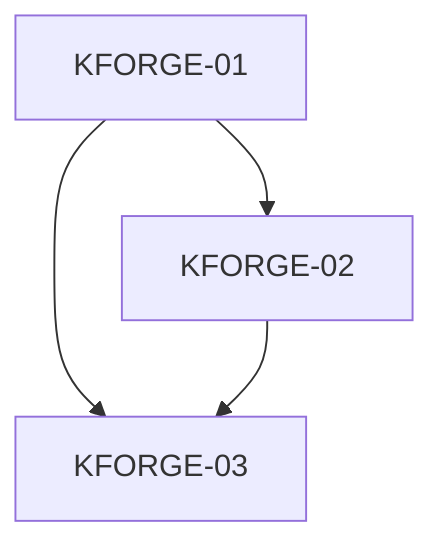

# [REQ-KFORGE-FOUNDATION] 实现拆分与交接计划

## 摘要

工程、协议与确定性打包。本次框架 3/3 已实现；实际模板 0 项 Deferred，未创建。 2026-10-19 用户纠正首批模板假设并授权框架执行；真实模板不再作为 CI、发布预览或框架验收前置。

## Resume Summary / 执行摘要

- Goal / 目标：工程、协议与确定性打包
- Current Status / 当前状态：Implemented
- Constraints / 关键约束：仅框架；真实模板由用户后续维护；无正式外发；单根包；模板开发在仓库外；LOCAL 不提交。
- Progress / 当前进展：本次框架 3/3 已实现；实际模板 0 项 Deferred，未创建。
- Key Decisions / 关键决策：用户已明确授权框架执行，取消首批实际模板前置；以临时 fixture 验收。
- Relevant Files / 相关文件：INDEX.md、../../design/technical-solution.md
- Commands Run / 已运行命令：Node 22.23.2 / pnpm 10.18.3；typecheck、build、13 项框架测试通过；空模板校验/打包/catalog dry-run 与实际 npm tarball 仓库外安装通过。
- Verified / 已验证：Node 22.23.2 / pnpm 10.18.3；typecheck、build、13 项框架测试通过；空模板校验/打包/catalog dry-run 与实际 npm tarball 仓库外安装通过。
- Open Questions / 待确认：真实模板内容/版本/优先级由用户后续决定；外发时再确定许可、包名与可信源。
- Next Steps / 下一步：用户可继续导入实际模板；如仅检查框架，使用根 README 命令。
- Blockers / 阻塞点：框架本机验收无阻塞；模板内容不在本次范围。
- Critical Context / 关键上下文：DES-BE-20261019-002，template-repository-implementation；template 任务 Deferred 不是框架缺陷。

## 输入文档

- [上游架构](../../design/architecture.md)：DES-BE-20261019-001，保留历史结构决策。
- [技术方案](../../design/technical-solution.md)：DES-BE-20261019-002，当前框架执行范围与实现接口。
- 最新用户指示：只生成框架，实际模板由用户后续慢慢写入或导入，立即执行框架任务。
- 原无 PRD、业务 wiki、数据库/API，未虚构应用事实。

## Complexity / 复杂度

- Score：4
- Level：M；总体 XL 已分四个父需求。
- Split Budget：2–4
- Actual Task Count：3（本次框架 3，Deferred 0）
- Why not more：按可独立验证模块交接；不把测试、文档或每个机械文件单独拆任务。
- Why not less：协议、网络完整性、解包/目录提交、维护入口与发行预览的失败出口不同；实际模板属于用户未来工作。

## 拆分策略

先工程/协议/打包，再生成引擎与维护工具，最后 fixture CI、catalog/CLI 发布预览及文档。实际顺序为串行；04/05 共用 distribution.ts，03/06 共用 archive.ts，不再标为可并行写入。保留 Deferred 文件名用于追溯，不移动到状态目录。

## Subtask Complexity Budget

| Task Code | Type | Complexity Drivers | Score | Decision |
| --- | --- | --- | --- | --- |
| KFORGE-01 | tooling | 无复杂驱动 | 0 | Keep；同原子能力，见子任务验证 |
| KFORGE-02 | protocol-contract | 无复杂驱动 | 0 | Keep；同原子能力，见子任务验证 |
| KFORGE-03 | template-pack | 安全负载边界 | 1 | Keep；同原子能力，见子任务验证 |

## Why Not Split

05 的下载与校验成功缓存属于同一个“只交付可信归档”的原子能力；网络故障、摘要/缓存污染均已有测试。14 现已收敛为无线上写入的发行预览，完整 catalog 合并/校验是预览产物的一致性边界；历史冲突、同版本替换与推荐回退均有测试。真正线上发布事务留待模板/托管建立后接入，未伪报完成。

## Refinement Plan / 细化计划

- Executable Tasks：本次框架已执行完毕，无待启动 worker；实现任务已按真实接口更新 Full 交接。
- Deferred Tasks：11/12/16–20 由用户后续维护。何时细化：用户选定并导入具体模板、锁定 SDK/原生验收后再开始，不作为本次交付阻塞。
- 共享契约现在来自 schemas/*.schema.json 与生成类型；模块真实落点见子任务。

## 批次规划与依赖图

## Parallel Queue / 并行执行队列

| 并行组 | 状态 | 可并行任务 | 前置依赖 | 阻塞任务 | 建议 worktree | 建议分支 | 写入范围 | 合并顺序 | 冲突预期 | 执行方式 | 备注 |
| --- | --- | --- | --- | --- | --- | --- | --- | --- | --- | --- | --- |
| G1 | Done | 无 | 无 | 无 | task-kforge-01（未创建） | task/kforge-01（未创建） | package.json, pnpm-lock.yaml, tsconfig.json, esbuild.config.mjs, .gitignore, .gitattributes, .prettierrc.json | 01 | 04/05 共用 distribution.ts；03/06 共用 archive.ts，已串行 | 已串行实现 | 本机验收；跨平台 CI 已配置但未运行 |
| G2 | Done | 无 | [KFORGE-01](KFORGE-toolchain-bootstrap-01.md) | 无 | task-kforge-02（未创建） | task/kforge-02（未创建） | schemas/, cli/src/core/protocol/, cli/src/core/errors.ts, scripts/generate-schemas.mjs | 02 | 04/05 共用 distribution.ts；03/06 共用 archive.ts，已串行 | 已串行实现 | 本机验收；跨平台 CI 已配置但未运行 |
| G3 | Done | 无 | [KFORGE-01](KFORGE-toolchain-bootstrap-01.md)、[KFORGE-02](KFORGE-protocol-contracts-02.md) | 无 | task-kforge-03（未创建） | task/kforge-03（未创建） | scripts/lib/template-pack.ts, scripts/validate-templates.ts, scripts/pack-templates.ts, cli/src/core/archive.ts | 03 | 04/05 共用 distribution.ts；03/06 共用 archive.ts，已串行 | 已串行实现 | 本机验收；跨平台 CI 已配置但未运行 |

## 共享契约

- JSON Schema → schemas.generated.ts → FromSchema 类型，schema 是字段真源。
- RemoteStore 固定 Snapshot/PublishedVersion；stageProject 返回 Stage；commitProject 返回完整项目路径；安装仅在完整生成后发生。
- 根 package/锁管理工具依赖；真实模板的各语言锁文件独立。
- 有效空模板仓库、默认空目录、预览 workflow 无线上写权限是当前执行边界。

## SQL Namespace

N/A。SQL Directory / SQL Order Range 均 N/A；无数据库或持久化任务。

## Trace Matrix / 功能点追溯矩阵

| 功能点 | 批次 | Task Code | 子任务文件 | 验收标准 |
| --- | --- | --- | --- | --- |
| 工程框架、单包范围、工具/模板依赖隔离、Git 忽略与字节稳定；实施方案 §2、§3；architecture §3/4/10 | B1 | KFORGE-01 | [KFORGE-toolchain-bootstrap-01.md](KFORGE-toolchain-bootstrap-01.md) | 框架 fixture、类型/构建与实际包检查；不要求真实模板 |
| 元数据驱动、模板输入、发布 include、版本兼容、生成溯源、错误与退出码；实施方案 §3/4/9；architecture §5/6/7 | B1 | KFORGE-02 | [KFORGE-protocol-contracts-02.md](KFORGE-protocol-contracts-02.md) | 框架 fixture、类型/构建与实际包检查；不要求真实模板 |
| 打包来源、手工回写边界、Git 跟踪与 include、运行产物防污染、确定性归档；实施方案 §4/5；architecture §5.1/5.2/7 | B1 | KFORGE-03 | [KFORGE-deterministic-pack-03.md](KFORGE-deterministic-pack-03.md) | 框架 fixture、类型/构建与实际包检查；不要求真实模板 |

## 发布与质量门禁

- typecheck/build/框架测试/实际 tarball 安装为本次本机验收；CI 配置 Node 22/24 × 三平台，但没有声称远端 runner 已运行。
- tests 只生成临时无技术栈 fixture；templates 当前仅 README，未创建业务应用模板。
- 发布前必须有真实模板验证、许可与托管配置；当前 workflows 只上传预览，无 npm publish、Release 或 Pages 部署。

## 风险与待确认

实际应用 SDK/平台构建、公开源连通和线上发布属于用户后续工作。当前 UNLICENSED，分发源 null；这些不阻塞框架本地使用或导入维护。

## 文档验证记录

Node 22.23.2 / pnpm 10.18.3；typecheck、build、13 项框架测试通过；空模板校验/打包/catalog dry-run 与实际 npm tarball 仓库外安装通过。 代码检查与新文档链接/任务状态同步检查见本次执行证据。没有提交用户工作区或发布外部产物。
